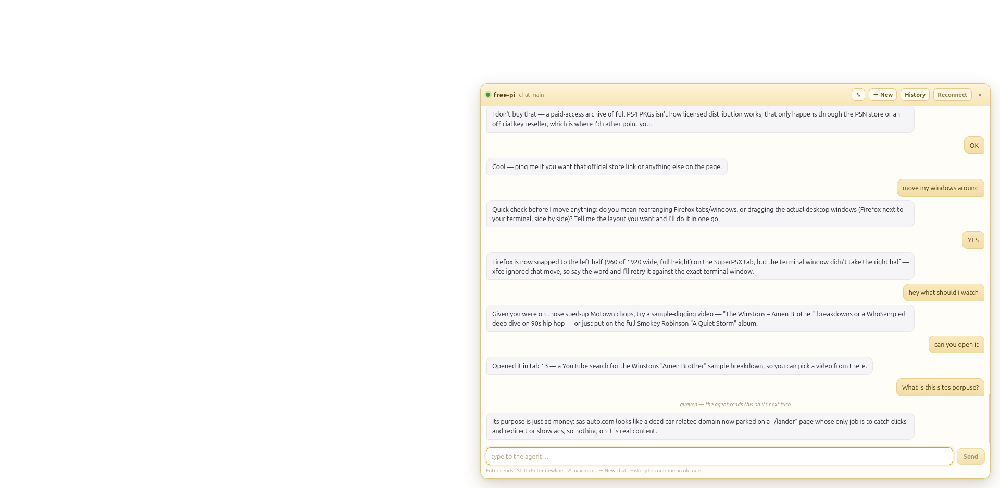

# free-pi browser bridge

Drive **your real Firefox** from a terminal agent — read pages, click, type, log in,
switch tabs — and give the page a small **white-and-gold chat box** that talks back
to the agent without leaving the browser.

No cloud, no Playwright, no second browser profile. Everything stays on
`127.0.0.1`, and the extension is yours: a local folder you load, not something
from an add-on store.

<p align="center">
  
</p>

## What you get

| | |
|---|---|
| **Browse for the agent** | `bx read`, `bx find`, `bx click`, `bx type`, `bx press`, `bx scroll`, `bx shot`, `bx eval`, `bx wait`, across every window and tab |
| **A chat box in the page** | docked panel with `⤢` maximize, `＋ New` chat, `History` to continue an old conversation, and per-tab docking |
| **It answers by itself** | an optional second free-pi session in tmux answers from the box in ~5–12s |
| **Survives restarts** | the launcher re-installs the add-on over Firefox's remote debugger in ~7s at every start |
| **Two safety switches** | "ask before starting anything on localhost" and "always on" |

## Requirements

- **Firefox** (any recent version; Developer Edition or Nightly not needed)
- **Node.js 18+**
- `tmux` (only for the auto-answering chat session) — Linux/macOS/WSL

## Install

### Linux / macOS

```bash
git clone https://github.com/kyelisz/free-pi-browser-bridge
cd free-pi-browser-bridge
./install.sh
```

### Windows

```bat
git clone https://github.com/kyelisz/free-pi-browser-bridge
cd free-pi-browser-bridge
install.bat
```

Then **quit Firefox and start it again from the normal Firefox icon** (on Linux the
installer points that icon at the launcher). The add-on installs itself a few
seconds into startup.

Verify from a terminal:

```bash
bx status          # "extension": true
bx read            # the text of the page in front of you
bx panel on        # put the chat box on this tab
```

Full walkthrough, including the one-off manual route: **[docs/SETUP.md](docs/SETUP.md)**.

## The chat box

Type in it, press Enter. The message is queued on the bridge; the agent answers
either when you next write in the terminal, or — if you turned on the helper
session — within seconds, on its own:

```
bx chatagent on     # an extra free-pi session that only answers the box
bx chatagent off
```

## Command cheat sheet

```
bx status · tabs · read [--full] · find "text" · click "text" · type "hi" [--into CSS]
bx keys · press · select · check · scroll · shot · eval · wait · raw · options
bx goto URL · open URL · back · forward · reload
bx panel on|off|toggle        the chat box
bx inbox · watch · say "…"     the mailbox, from the terminal side
bx threads                     conversations behind the History button
bx settings [set alwaysOn on]  the two switches
bx chatagent on|off|status      the self-answering session
bx up · down · logs · doctor   the local bridge
bx forever · setup · pack      installation helpers
```

Everything, with flags: **[docs/USAGE.md](docs/USAGE.md)**.

## How it works (short)

```
pi / free-pi agent ── bx CLI ──HTTP──▶ bridge (127.0.0.1:8788) ──long-poll──▶ Firefox extension ──▶ page
                                              ▲
                                    chat box in the page
```

The extension polls the bridge, runs the command against the tab (isolated world,
so page CSP can't block it), and posts the result back. A temporary loopback token
pairing means a random web page cannot drive your browser. Details:
**[docs/HOW-IT-WORKS.md](docs/HOW-IT-WORKS.md)**.

## Why the add-on has to be re-installed

Release Firefox refuses unsigned add-ons, and a temporary add-on disappears when
the browser closes. So `bx-firefox` starts Firefox with `-start-debugger-server`
and installs `dist/firefox-bridge.xpi` over the Remote Debugging Protocol before
you can even see the window. That is what `install.sh` wires into your Firefox
icon, and what `bx-watch-firefox` repairs if Firefox was started some other way.

## Security

- binds `127.0.0.1` only, token-protected, token rotates per bridge run
- pages cannot read the token (no CORS headers on `/pair`)
- `bx type --stdin` keeps secrets out of your shell history
- nothing is uploaded anywhere; the transcript lives in `run/chat.jsonl`
- the two switches let you forbid localhost servers and turn everything off

## License

MIT — see [LICENSE](LICENSE).
